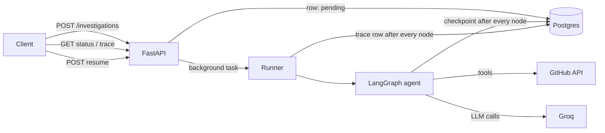
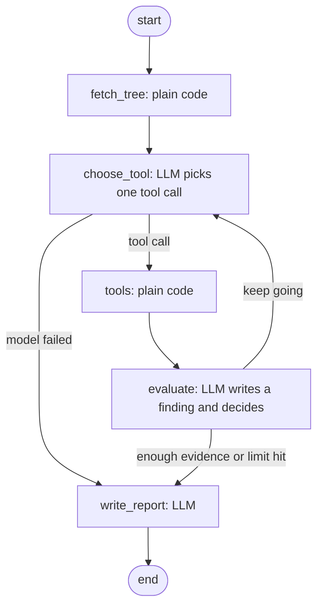

# Repo Investigator

An agent that investigates a GitHub repository for you. Give it a repo URL and an optional focus ("how does authentication work?"). It explores the repo with tools, takes notes as it goes, and writes a structured report. Every step is traced in the database, and a run that gets interrupted can be resumed from its last checkpoint.

I built it as a small system to get the runtime right, not just the prompt: an agent loop, persistent state, real tool execution, tracing, and failure handling.

## What it does

- `POST` a public GitHub URL and an optional focus. You get an id back immediately (`202`), and the work continues in the background.
- The agent lists folders, reads files in chunks, searches inside files, and writes one finding per file part it reads.
- It stops when it has enough evidence, or when a hard limit is hit (steps or tokens), and then writes the final report.
- With a focus, the report answers it and says whether it was fully answered, partly answered, or not found. Without one, it is a general overview.
- You can poll the status, read the full step-by-step trace, and resume a run that was interrupted.

## Architecture



The agent graph:



### Layout

```
backend/
  main.py                  app, lifespan (opens the checkpointer, marks dead runs interrupted)
  app/
    agent/
      graph.py             builds the graph, initial state
      nodes/               first_node (fetch_tree), second_node (choose_tool),
                           third_node (evaluate), final_node (write_report)
      tools.py             list_directory, read_repository_file, search_in_file
      github_client.py     GitHub API client: retries, error mapping, chunked reads
      llm.py               model calls: rate-limit waits, JSON output, tool-call retries
      checkpoint.py        the only place that knows checkpoints live in Postgres
      prompts.py           all prompts
      state.py             the agent state
    investigations/        models, router, service (the background runner)
  migrations/              Alembic
  tests/
```

## How one run works

1. **Create.** The endpoint validates the URL, stores an `investigations` row as `pending`, schedules the runner, and returns `202` with the id.
2. **Run.** The runner marks the row `running` and streams the graph. After every node it writes a `trace_steps` row and updates the counters on the investigation.
3. **fetch_tree** (no LLM). Fetches repo metadata and the file tree.
4. **choose_tool** (LLM). Sees the focus, repo info, findings so far, and which files were read. It must return exactly one tool call. It cannot execute anything.
5. **tools** (no LLM). Runs the chosen tool against the GitHub API.
6. **evaluate** (LLM). Turns the file part that was just read into a short finding, decides to keep going or stop, and suggests what to look at next. After a listing, a search, or an error there is nothing to summarize, so it skips the model call.
7. **Limits** are plain Python in `evaluate`: step limit, token budget, then the model's own "done". The model can never keep the loop alive.
8. **write_report** (LLM). Builds the report from the findings only. Facts that can be computed (files read, steps, stop reason) are added by code, not by the model.
9. The runner stores the report and sets the status to `completed`.

### Tools

| Tool | What it does |
|---|---|
| `list_directory` | Lists one folder. Works from the tree already in state, so no network call |
| `read_repository_file` | Reads a file in chunks. The result says where it ended and what offset to use for the next part |
| `search_in_file` | Finds where a name appears in one file and returns line numbers and character offsets, so the agent can jump to the right chunk |

The model only chooses paths and offsets. The repo, branch, and state come from the run itself (`InjectedState`), so it cannot wander to another repository.

## State, checkpoints, and recovery

Three different kinds of saved data, on purpose:

| | Purpose | Contents | Lifetime |
|---|---|---|---|
| `investigations` row | the product | status, report, findings, token totals | permanent |
| `trace_steps` | people reading what happened | one row per node: thought, tool, input, output preview, tokens, duration, errors | permanent, append-only |
| LangGraph checkpoints | the machine continuing a run | the full state after every node, plus what runs next | disposable |

The trace is the security-camera footage and the checkpoint is the save file. You watch one to understand a run and load the other to continue it.

**Resume.** On startup, any run still marked `pending` or `running` was killed by a restart, so it is marked `interrupted`. `POST /investigations/{id}/resume` loads the last checkpoint and continues from the next node. It claims the run with one atomic `UPDATE ... WHERE status IN ('interrupted','failed')`, so two clicks cannot start two agents on the same run. The trace shows a `resume` row at each seam and keeps counting steps from where it stopped.

If the server dies in the middle of a node, that node runs again from its start. That is safe here because every tool only reads.

I tested it by stopping the server twice during one run and resuming each time: `fetch_tree` ran once, the trace shows two `resume` rows, step numbers are continuous, and the run completed.

## Tracing

Every node writes a row to `trace_steps`:

`step`, `node`, `thought`, `tool_called`, `tool_input`, `tool_output` (a preview, never whole files), `output_chars`, `is_error`, `duration_ms`, `tokens_in`, `tokens_out`.

`GET /api/v1/investigations/{id}/trace?after=N` returns only the rows after step N, so a client can poll for new steps. The evaluate rows record the finding, whether the agent decided to continue or stop, and what it plans to look at next.

## Failure handling

| What goes wrong | What happens |
|---|---|
| GitHub 5xx or network error | 3 attempts with exponential backoff, then a clear "GitHub is not responding" error |
| Repo not found or private | `RepoNotFound`, run ends `failed` with a readable message |
| GitHub rate limit | `RateLimited` with the reset time. The run ends `failed` and can be resumed later |
| LLM provider rate limit (429) | Waits as long as the provider asks, up to 4 attempts, then fails with "busy, try again" and can be resumed |
| Model calls a tool that does not exist, or returns invalid JSON | Retried with a changed prompt (at temperature 0 the same input gives the same output) |
| Model keeps failing in `choose_tool` | The graph goes to `write_report` with `stop_reason = model_error`, so the user gets a partial report |
| Binary or huge files | Binary files are refused. Large files are read in chunks |
| Server restart | The run becomes `interrupted` and can be resumed |
| Loop that never ends | Step limit and token budget, both enforced in code |

## Design decisions

- **The LLM chooses, code executes.** The model returns a tool call and plain code runs it. Tools can be tested without a model, and the model cannot do anything outside the tool list.
- **Limits live outside the model.** Whether to stop is a mix of model judgment and hard rules, and the hard rules win.
- **Findings, not raw files, carry the state.** After a file is summarized, its text in the message history is replaced with a short stub, so token use does not grow with every file read.
- **A file counts as "read" only if it produced a finding.** A failed evaluation does not mark it done.
- **Postgres for checkpoints, not Redis.** Durable by default, inspectable with SQL, one database for everything. The choice lives in one function (`checkpoint.py`), so moving to Redis later changes only that file.
- **Trace and checkpoint are separate.** One is for reading, one is for continuing, and they need different data.
- **Two model modes.** Tool calls use the provider's tool calling. The JSON outputs (findings, report) ask for plain JSON and validate it with Pydantic, because the structured-output path was unreliable with this model (it sometimes invented tool names).

## Measured behavior

On `pallets/click`: about 21K to 32K input tokens and about 4K output tokens per run, 8 to 11 tool rounds, 4 to 5 findings.

Early traces showed some model calls taking 10 to 30 seconds while producing only a few hundred tokens, against about 1 to 2 seconds for similar calls. The server log showed why: the provider answered `429` and its SDK waited 16, 22, and 44 seconds before retrying. On the free tier the token-per-minute limit, not the work, dominates the run time. Calls are now wrapped so waits are explicit and bounded.

## API

All routes are under `/api/v1` and need a logged-in user (cookie auth; see `/docs` for the auth routes).

| Method | Path | Description |
|---|---|---|
| POST | `/investigations` | Start a run. Body: `repo_url`, optional `focus`. Returns `202` and the id |
| GET | `/investigations` | Your recent runs |
| GET | `/investigations/{id}` | Status, counters, error, and the report when finished |
| GET | `/investigations/{id}/trace?after=N` | Trace rows after step N |
| POST | `/investigations/{id}/resume` | Resume an `interrupted` or `failed` run. `409` if there is nothing to resume |

Statuses: `pending`, `running`, `completed`, `failed`, `interrupted`.

## Running it

You need Python 3.12 or newer, Postgres, Redis, and a [Groq](https://console.groq.com) API key. A `GITHUB_TOKEN` is optional, but without one GitHub allows only 60 requests per hour.

### With Docker

```bash
cp backend/.env.example backend/.env     # add GROQ_API_KEY, set the two token secrets
docker compose up --build
```

This starts Postgres and Redis, applies the migrations, and serves the API on `http://localhost:8000` (docs at `/docs`).

### Locally

```bash
cd backend
python -m venv .venv && source .venv/bin/activate    # on Windows: .venv\Scripts\activate
pip install -r requirements.txt
cp .env.example .env                                  # fill it in
alembic upgrade head
uvicorn main:app
```

The checkpoint tables are created by LangGraph itself on startup, outside Alembic. `migrations/env.py` ignores tables that start with `checkpoint`, so `alembic check` stays clean.

### Tests

```bash
cd backend && pytest -q
```

## Known limitations

- **A crash re-runs the node that was in progress.** Its model call is paid for again, the tokens of the lost call are not counted, and a trace row can appear twice. The `resume` row marks the seam.
- **Checkpoints depend on the shape of the state.** Changing the state can break resuming runs saved before the change. Treat checkpoints as disposable across deploys.
- **Runs are FastAPI background tasks inside the API process.** A restart interrupts them (resume recovers them), and the startup cleanup assumes a single server process. A real queue and worker is the next step for scale.
- **Reports are built from short findings, not from the code.** The model can add details it knows about a famous library but did not read. The report lists which files were read and its own limitations. Large files are read in parts, so a finding may describe only the part that was read.
- **Overview mode does not read manifest files first**, so the tech stack can be thin.
- **Free-tier model limits** make runs slow when the token-per-minute limit is hit.
- **Each node adds database round trips** (trace row and checkpoint). On a remote database this is visible latency.
- Public repositories only. No per-user quotas and no cancel endpoint yet.

## What I would do next

1. Read the README and the manifest (`pyproject.toml`, `package.json`, ...) in plain code right after `fetch_tree`, so overviews have a solid base.
2. Check report claims against the findings and drop anything unsupported.
3. Write trace rows in batches, and stream them to the client over SSE.
4. Per-user quotas, cancel, and a queue with a separate worker.
5. Make the model provider a config choice.

## Stack

FastAPI, SQLAlchemy (async) and Alembic, PostgreSQL, Redis, LangGraph with the Postgres checkpointer, `langchain-groq`, httpx, Pydantic.

Built by Taha Yasin ([TahaY291](https://github.com/TahaY291)).# github_repo_analyzer

