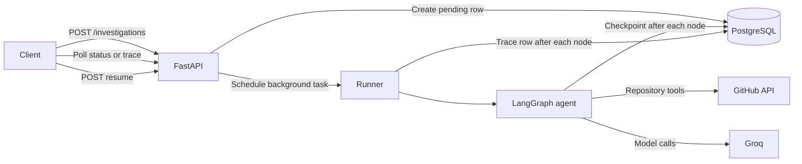
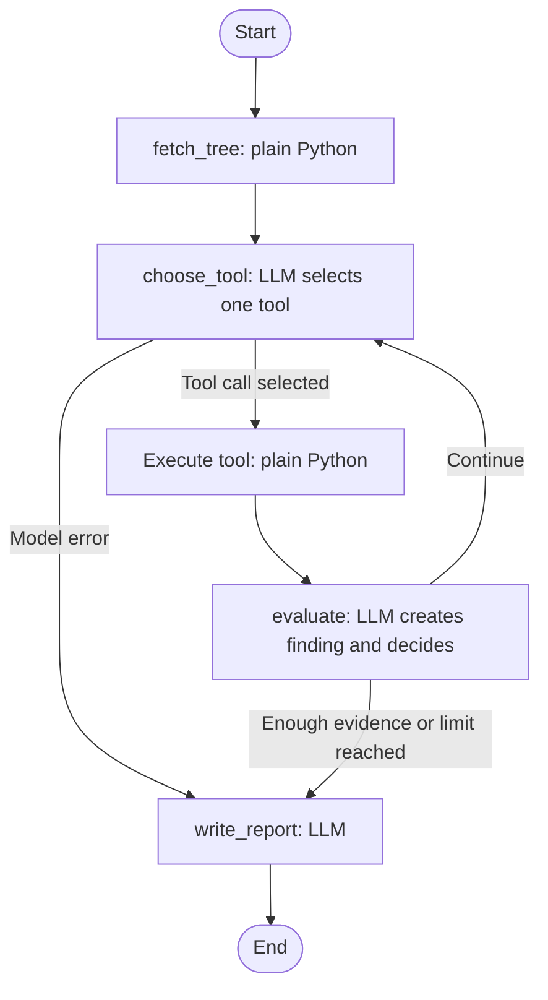

Repo Investigator
An AI agent that investigates a public GitHub repository and produces a structured report. Give it a repository URL and an optional focus question, such as “How does authentication work?” It explores the code with tools, records findings and execution traces, and can resume an interrupted run from its last checkpoint.

The project focuses on reliable agent execution—not just prompting—including tool execution, persistent state, tracing, limits, and failure recovery.
Features
- Start an investigation asynchronously and receive a run ID immediately (202 Accepted).
- Explore repository folders, read files in chunks, and search within files.
- Record findings and a step-by-step trace in PostgreSQL.
- Poll run status and inspect the trace.
- Resume interrupted or failed runs from a saved checkpoint.
- Generate a focused report that says whether the question was fully answered, partly answered, or not found.
- Enforce step and token limits in code.
Tech Stack
- API: FastAPI, Pydantic
- Agent workflow: LangGraph, langchain-groq
- Database: PostgreSQL, SQLAlchemy (async), Alembic
- Cache/service dependency: Redis
- GitHub access: GitHub API, httpx
- Runtime: Docker Compose
Architecture

Agent workflow

How an Investigation Works
1. Create: The API validates the repository URL, stores an investigations row with pending status, schedules the runner, and returns 202 with the run ID.
2. Start: The runner marks the investigation running and streams the graph. After each node, it writes a trace_steps row and updates investigation counters.
3. Fetch repository tree: fetch_tree retrieves repository metadata and the file tree without an LLM call.
4. Choose a tool: choose_tool gives the model the focus question, repository information, existing findings, and files already read. The model selects exactly one tool call; it does not execute the tool itself.
5. Execute the tool: Plain Python calls the GitHub API through the selected tool.
6. Evaluate: The model turns the newly read file part into a concise finding and decides whether more evidence is needed. After a directory listing, search, or error, there may be nothing to summarize, so the model call is skipped.
7. Enforce limits: Python enforces the step limit and token budget. The model's decision to stop is also considered, but it cannot bypass hard limits.
8. Write the report: The model builds a report from findings. Facts such as files read, step counts, and stop reason are added by code.
9. Complete: The runner stores the report and marks the investigation completed.
Repository Layout
backend/
├── main.py
├── app/
│   ├── agent/
│   │   ├── graph.py
│   │   ├── nodes/
│   │   │   ├── first_node.py
│   │   │   ├── second_node.py
│   │   │   ├── third_node.py
│   │   │   └── final_node.py
│   │   ├── tools.py
│   │   ├── github_client.py
│   │   ├── llm.py
│   │   ├── checkpoint.py
│   │   ├── prompts.py
│   │   ├── state.py
│   │   └── tree_view.py
│   ├── auth/
│   ├── core/
│   └── investigations/
├── migrations/
├── scripts/
├── docs/
├── Dockerfile
├── .dockerignore
├── .env.example
└── requirements.txt
docker-compose.yml
README.md
Key modules:
- graph.py builds the LangGraph workflow.
- nodes/ contains the fetch, tool-selection, evaluation, and report-writing nodes.
- tools.py implements directory listing, chunked file reading, and in-file search.
- github_client.py handles GitHub API calls, retries, error mapping, and chunked reads.
- llm.py handles model calls, rate-limit waits, JSON output, and tool-call retries.
- checkpoint.py centralizes the PostgreSQL checkpoint configuration.
- investigations/ contains the API routes, models, service, and background runner.
- migrations/ contains Alembic migrations.
Tools
Tool	Purpose
list_directory	Lists a folder using the repository tree already stored in state; no additional network call is needed.
read_repository_file	Reads a file in chunks and returns information needed to request the next chunk.
search_in_file	Finds a name or phrase in a file and returns line numbers and character offsets to help the agent jump to the relevant chunk.

The model chooses paths and offsets. The repository, branch, and current state come from the investigation itself (InjectedState), preventing a tool call from switching to another repository.
State, Checkpoints, and Recovery
The application stores three different kinds of data:
Record	Purpose	Contents	Lifetime
investigations	Represents the investigation	Status, report, findings, token totals	Permanent
trace_steps	Explains what happened	One row per node: thought, tool, input, output preview, tokens, duration, and errors	Permanent, append-only
LangGraph checkpoints	Allows a run to continue	Full state after each node and the next node to execute	Disposable

A useful analogy: the trace is the recording of what happened, while the checkpoint is the save file used to continue.
Resume behavior
- On startup, runs still marked pending or running are marked interrupted.
- POST /api/v1/investigations/{id}/resume loads the last checkpoint and continues from the next node.
- The service claims a run with one atomic UPDATE ... WHERE status IN ('interrupted','failed'), preventing two requests from starting the same run at once.
- A resume trace row marks each restart seam, and step numbering continues from the saved progress.
- If the server dies in the middle of a node, that node runs again from its start. This is safe for the current read-only tools, although the model call may be paid for again.
I tested recovery by stopping the server twice during a run and resuming each time. In that test, fetch_tree ran once, the trace showed two resume rows, step numbers remained continuous, and the investigation completed.
Tracing
Every node writes a row to trace_steps, including fields such as:

step, node, thought, tool_called, tool_input, tool_output (preview only), output_chars, is_error, duration_ms, tokens_in, and tokens_out.

GET /api/v1/investigations/{id}/trace?after=N returns trace rows after step N, allowing a client to poll for new steps. Evaluation rows record the finding, whether the agent chose to continue or stop, and what it plans to inspect next.
Failure Handling
Failure	Behavior
GitHub server error or network failure	Retries three times with exponential backoff, then returns a clear error.
Repository not found or private	Raises RepoNotFound; the run ends as failed with a readable message.
GitHub rate limit	Raises RateLimited with the reset time; the run can be resumed later.
LLM provider rate limit (429)	Waits according to the provider's requested delay, up to four attempts, then fails with a retryable message.
Unknown tool or invalid JSON from the model	Retries with a changed prompt.
Repeated failure in choose_tool	Moves to report writing with stop_reason = model_error, allowing a partial report.
Binary or very large file	Binary files are refused; large files are read in chunks.
Server restart	The run becomes interrupted and can be resumed.
Agent loop does not stop	Python-enforced step and token limits stop it.

Design Decisions
- The LLM chooses; code executes. Tool calls are executed by plain Python. Tools can be tested independently, and the model is restricted to the available tool list.
- Hard limits live outside the model. Stopping combines model judgment with enforced rules; the rules take precedence.
- Findings, not raw files, carry the state. After a file part is summarized, its text in the message history is replaced with a short stub to keep token use from growing with every read.
- A file counts as read only when it produces a finding. A failed evaluation does not mark it as completed.
- PostgreSQL stores checkpoints. Checkpoints are durable and inspectable with SQL. The configuration is centralized in checkpoint.py, so changing the storage backend later is localized.
- Trace and checkpoint data are separate. One explains execution to a person; the other allows execution to continue.
- Two model-output modes are used. Tool selection uses provider tool calling. Findings and reports use JSON validated with Pydantic because the structured-output path was unreliable with this model.
Measured Behavior
On pallets/click, a run used approximately 21K–32K input tokens and 4K output tokens, with 8–11 tool rounds and 4–5 findings.

Early traces showed some model calls taking 10–30 seconds while generating only a few hundred tokens, compared with about 1–2 seconds for similar calls. Server logs showed provider 429 responses followed by SDK waits of 16, 22, and 44 seconds. On the free tier, the token-per-minute limit—not repository exploration—can dominate runtime. Calls are now wrapped so waits are explicit and bounded.
API
All investigation routes are under /api/v1 and require a logged-in user. Authentication routes are available in /docs.
Method	Endpoint	Description
POST	/investigations	Starts a run. Body: repo_url and optional focus. Returns 202 and the run ID.
GET	/investigations	Lists your recent runs.
GET	/investigations/{id}	Returns status, counters, errors, and the report when complete.
GET	/investigations/{id}/trace?after=N	Returns trace rows after step N.
POST	/investigations/{id}/resume	Resumes an interrupted or failed run; returns 409 if it cannot be resumed.

Possible statuses: pending, running, completed, failed, and interrupted.
Getting Started
Prerequisites
- Docker Desktop with Docker Compose
- A Groq API key
- A GitHub token is optional; without one, GitHub's unauthenticated API limit is 60 requests per hour
Run with Docker
1. Clone the repository:
   git clone https://github.com/TahaY291/repo_analyzer_agent.git
   cd repo_analyzer_agent
2. Create your local environment file:
   cp backend/.env.example backend/.env
   On Windows PowerShell, use:
   Copy-Item backend/.env.example backend/.env
3. Edit backend/.env. Add GROQ_API_KEY and set the required token secrets. Do not commit this file.
4. Build and start the services:
   docker compose up --build
This starts PostgreSQL and Redis, applies database migrations, and serves the API on http://localhost:8000. Open the interactive API docs at http://localhost:8000/docs.

To stop the services, press Ctrl+C. Then run docker compose down if needed. The named PostgreSQL volume is retained by default.
Run Locally Without Docker
The backend requires Python 3.12 or newer, PostgreSQL, Redis, and the environment variables described in .env.example.
cd backend
python -m venv .venv
Activate the environment:
# macOS/Linux
source .venv/bin/activate

# Windows PowerShell
.venv\Scripts\Activate.ps1
Install dependencies and configure the environment:
pip install -r requirements.txt
cp .env.example .env
On Windows PowerShell, use Copy-Item .env.example .env instead of cp if needed. Fill in the required values, then run:
alembic upgrade head
uvicorn main:app
LangGraph creates its checkpoint tables on startup, outside Alembic. migrations/env.py ignores tables beginning with checkpoint, so alembic check stays clean.
Tests
From the backend/ directory:
pytest -q
Known Limitations
- A crash during a node causes that node to run again from the beginning. Its model call may be billed again, lost-call tokens are not counted, and a trace row may appear twice. The resume row marks the restart seam.
- Checkpoints depend on the state shape. Changing the state can break resumes for older runs; treat checkpoints as disposable across deployments.
- Runs use FastAPI background tasks inside the API process. A restart interrupts them, and startup cleanup assumes a single server process. A durable queue and separate worker would be the next scaling step.
- Reports are built from findings, not directly from the entire repository. The model may add unsupported details about familiar libraries; the report lists files read and its limitations. Large files are read in parts, so a finding may describe only the part inspected.
- Overview mode does not read manifest files first, so its technology-stack summary may be incomplete.
- Free-tier model limits can make runs slow.
- Each node adds database round trips for trace rows and checkpoints, which can add noticeable latency with a remote database.
- Only public repositories are supported. Per-user quotas and a cancellation endpoint are not implemented yet.
Possible Next Steps
1. Read manifest files such as pyproject.toml and package.json after fetch_tree to improve overview reports.
2. Check report claims against findings and remove unsupported statements.
3. Batch trace writes and stream trace updates to clients over SSE.
4. Add per-user quotas, cancellation, and a queue with a separate worker.
5. Make the model provider configurable.
Author
Built by Taha Yasin.